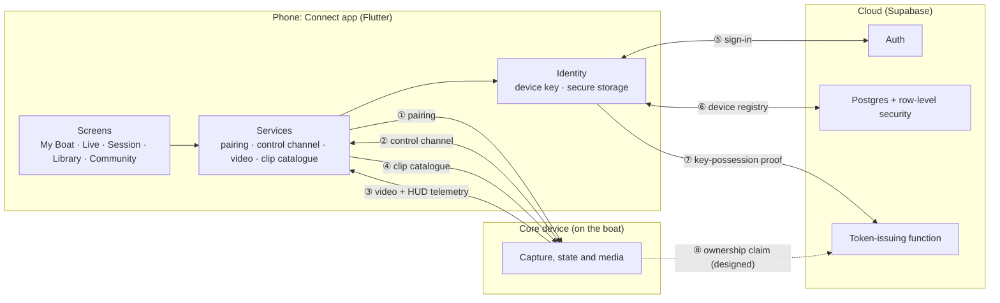

# Architecture

Connect has three parts: the phone app, the Core device on the boat, and a Supabase cloud backend. The phone talks to the Core over the boat's local network and to the cloud over the internet. The Core is the authority for anything happening on the boat. The cloud is the authority for accounts and for which phones are registered to which people.

| # | Channel | Transport | What travels on it |
|---|---|---|---|
| ① | Pairing | HTTPS, one request | The phone's public key and display name. Only accepted while a pairing window is open on the device. |
| ② | Control channel | WebSocket over TLS | An auth frame first, then sequenced state messages, commands and acknowledgments, plus WebRTC signalling. |
| ③ | Video and HUD telemetry | WebRTC media track + data channel | Live video, and per-frame tracking data for the overlay. Loss-tolerant; each packet parsed on its own. |
| ④ | Clip catalogue | HTTPS with the paired credential | The list of recorded clips and the media itself. |
| ⑤ | Sign-in | HTTPS (Supabase Auth) | Human authentication and sessions. |
| ⑥ | Device registry | Postgres with row-level security | Registering and revoking this phone on the user's account. |
| ⑦ | Key-possession proof | HTTPS to a token-issuing function | A short-lived proof signed by the phone's registered key, exchanged for an identity token bound to that key. |
| ⑧ | Ownership claim | Relayed by the phone | A claim signed by the device itself, verified in the cloud. Designed and contract-tested from the app side; not live yet. |

## Phone app

**Responsibilities**
- Presents device state, live video, the clip library and community features.
- Runs the pairing flow and keeps the resulting credential in platform secure storage (Keystore-backed encrypted storage on Android, the target platform today).
- Generates and holds the phone's device keys. Only public keys leave the phone.
- Holds one authenticated control-channel connection to the Core, and reconnects with bounded exponential backoff (1 s, doubling up to 32 s).
- Signs the user in through Supabase and registers the phone as a device on their account.

**Boundaries**
- The app never changes device state optimistically. It sends a command, marks it pending, and updates only when the Core reports new state.
- The app's role checks (owner, crew, spectator) decide which controls are enabled. They are a convenience for the user, not the security boundary: the Core re-checks every command.
- Commands that would switch off safety features don't exist in the client at all. Trying to send one is rejected before a message is built.
- The mode is fixed when the app is compiled. A demo build makes no network connections to a device. A device build refuses to start without a configured device address rather than falling back to demo data.

## Core device

**Responsibilities**
- Owns capture, recording, device health and the safety features.
- Opens a short pairing window when its physical button is pressed or when an existing owner asks for one, and issues a credential to a phone during that window.
- Publishes sequenced state messages on the control channel, acknowledges commands, and serves video over WebRTC and recorded clips over HTTPS.

**Boundaries**
- It is the source of truth for everything on the boat. The phone treats a missing acknowledgment as "unknown", never as success.
- Its capture and vision software lives in a separate private codebase and is out of scope for this showcase.
- The phone-side contract for these channels is implemented and tested; end-to-end runs against production Core hardware are the next milestone.

## Cloud (Supabase)

**Responsibilities**
- **Auth:** human sign-in and sessions.
- **Postgres:** accounts, registered phones and device ownership records, all behind row-level security so a user can only ever see their own rows.
- **Token function:** exchanges a proof signed by a registered phone's key for a short-lived identity token bound to that key. It is written and contract-tested from the app side, but not yet deployed.

**Boundaries**
- Signing in as a person and registering a phone are separate steps. Registering a phone never signs anyone in or changes who is signed in.
- Revoking a phone happens in the cloud first. The phone discards its key only after the cloud confirms that exact device is revoked; if that fails, nothing changes on the phone.
- Every schema migration ships with SQL tests that run in CI.

## Testing approach

- Network clients (pairing, control channel, clip catalogue, WebRTC signalling) are written against injectable transports, so the tests drive real request and response handling through fakes and loopback sockets instead of mocking the logic away.
- Key generation and persistence are tested with real elliptic-curve keys against an in-memory secure store.
- The database tests check row-level security from the point of view of different users.
- A static policy audit runs in CI alongside the tests.
