# Binnacle Connect — showcase

Binnacle is a marine telemetry and edge-AI platform for tow-sport boats. **Connect** is the phone and cloud companion app I build for it: it pairs with the on-board Core device, shows live telemetry and video, and manages recorded clips. The product source code is private. This repository is a showcase of the app, its architecture and the engineering decisions behind it — documentation and media only, no product code.

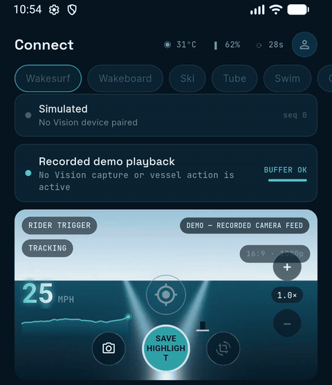

*Demo mode on an Android emulator. The camera feed is a synthetic recording bundled with the app; no hardware is connected.*

**[Watch the 90-second demo](media/video/binnacle-connect-demo-90s.mp4)**: pairing, the live view and the clip library, with captions ([captions.srt](media/video/captions.srt)).

## What's in the app

- **Pairing.** Scan the QR label on the Core device (or type its code), and the phone generates its own device key, keeps the private half in platform secure storage, and sends only the public key with its registration request. The QR label carries no secret, and pairing only succeeds while a pairing window is open on the device itself. A unit that reports no previous owner triggers an explicit "this unit had no previous owner" warning instead of being claimed silently.
- **Live telemetry.** Device state (link status, temperature, storage, capture state) arrives over an authenticated WebSocket control channel. The same channel carries commands and their acknowledgments.
- **Live video.** A WebRTC client renders video from the Core device, with a HUD drawn from a separate telemetry data channel.
- **Clip library.** Highlights, snapshots and safety clips, with filters, favourites, in-app playback, sharing and download.
- **Accounts.** Sign-in and account management backed by Supabase Auth.
- **Demo mode.** A build flag that runs the whole app with no hardware and no network connection, clearly labelled as demo everywhere. Every screenshot and clip in this repo was taken in demo mode.

**Status, plainly:** the app's side of pairing, the control channel, WebRTC video and the clip catalogue is implemented and covered by tests against fakes, loopback sockets and an emulator. It has not yet been run end to end against production Core hardware; that integration is the next milestone.

## How it's built

- **App:** Flutter/Dart, one codebase for Android and web. The field device also has native Android modules, which live in a separate private codebase.
- **Cloud:** Supabase Auth plus Postgres with row-level security. Every schema migration ships with SQL tests that run in CI.
- **CI:** GitHub Actions runs the app checks (static analysis, unit and widget tests, web and Android builds, and a static policy audit) and the database tests on every change.
- **Tests:** 30 test suites in the app, plus the database tests.
- **History:** 140+ commits since September 2026.
- **How I work:** I use AI coding agents (Claude Code and Gemini) for implementation, test writing and review passes. I review every change, and nothing merges unless CI is green.

## Design decisions I'd defend in an interview

- **Keys are generated on the phone, and the private key never leaves secure storage.** Only the public key ever crosses the network. The signing interface has no method that returns the private key, so moving to a hardware-bound key (Android Keystore, Secure Enclave) doesn't touch any caller.
- **The QR code on the device is not a credential.** Someone who photographs the label on your boat gains nothing. Pairing also needs a pairing window opened by a physical button on the unit or by an existing owner, so the root of trust is physical access to the boat.
- **Control and video run on separate channels.** Commands need to be authenticated, ordered and acknowledged. Video and HUD telemetry need low latency and can tolerate a lost packet. Keeping them apart means a stalled video stream can never delay a safety acknowledgment, and every telemetry packet is parsed on its own, so a malformed one is dropped instead of breaking the render loop.
- **The device is the source of truth, and the app never guesses.** A tapped command shows as pending until the device sends back new state. After a reconnect, outstanding commands are failed, not replayed, and state messages whose sequence number doesn't increase are discarded.
- **Freshness is measured on a monotonic clock from when the phone received data, not from the device's own timestamp.** Neither a wrong device clock nor a change to the phone's clock (network time sync, travel across time zones) can make stale data look live or live data look stale. The link shows "not responding" after 15 seconds of silence and goes offline after 45.
- **Demo mode is fixed at compile time, never a runtime switch.** A demo build cannot open a connection to a device, and a device build cannot quietly fall back to fake data. That makes it safe to hand someone the demo, and nothing simulated can be mistaken for the real thing.

## Hardware path

Two pieces of hardware are in build: an ESP32 bridge that reads the engine's analog senders and publishes them on the boat's NMEA 2000 network, and a camera head built around GMSL2-serialized sensors, with the compute board still being chosen (Orin NX vs RK3588). Neither is running on a boat yet, and I don't have bench photos I'm ready to publish.

## Gallery

| | | |
|:---:|:---:|:---:|
| 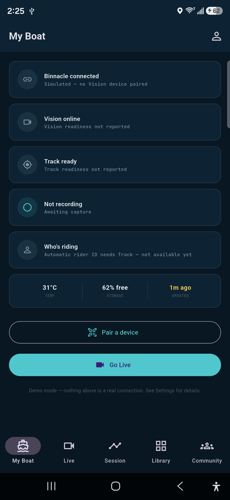 **My Boat**: device, camera and capture status at a glance, with the Pair entry point. | 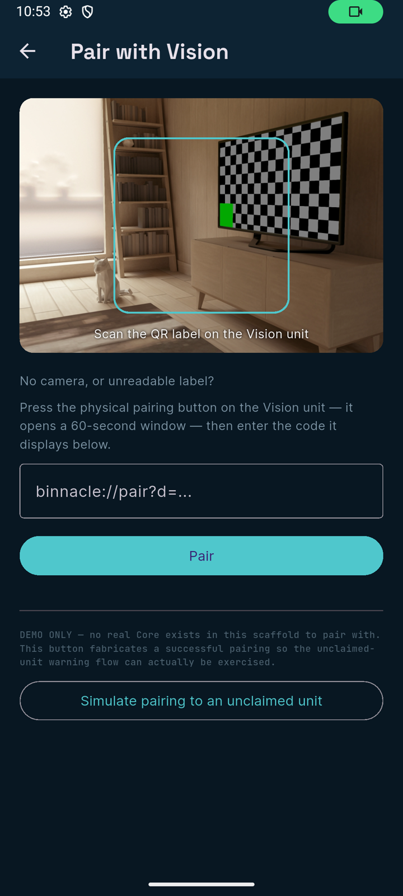 **Pairing**: QR scan with a manual-code fallback. | 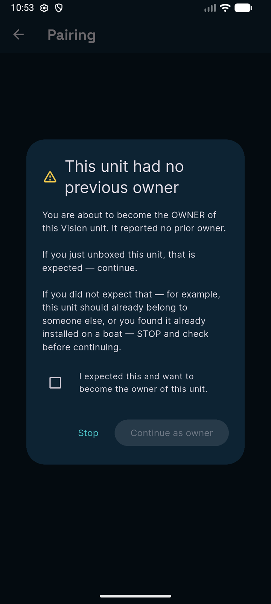 **Unclaimed unit**: a unit with no previous owner is surfaced, never claimed silently. |
| 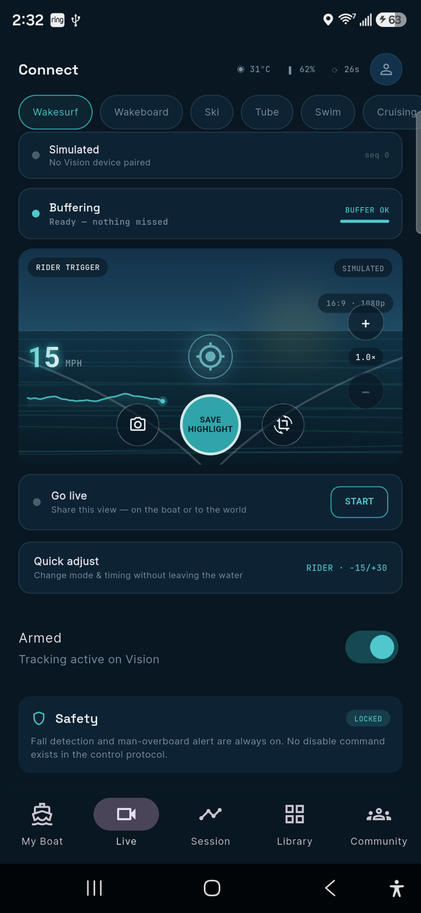 **Live**: link state, speed telemetry, zoom, snapshot and highlight controls. | 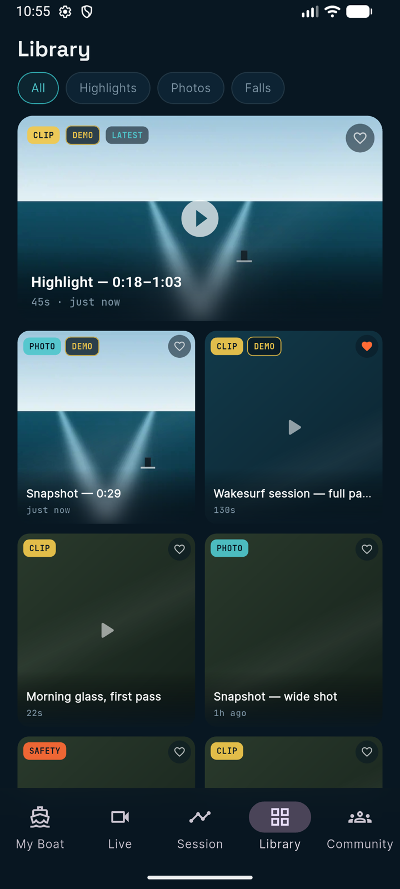 **Library**: highlights, photos and safety clips, with filters and favourites. | 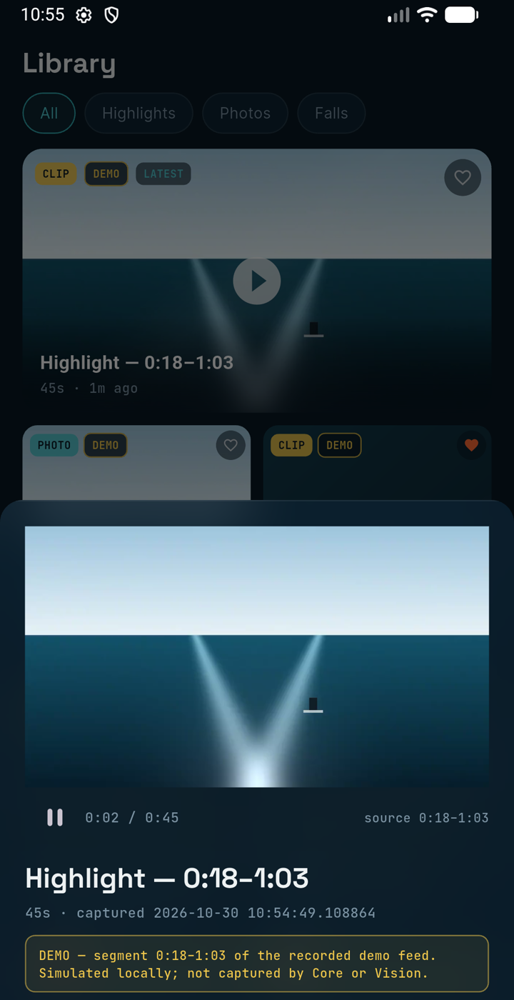 **Playback**: in-app player; demo media is labelled as demo. |
| 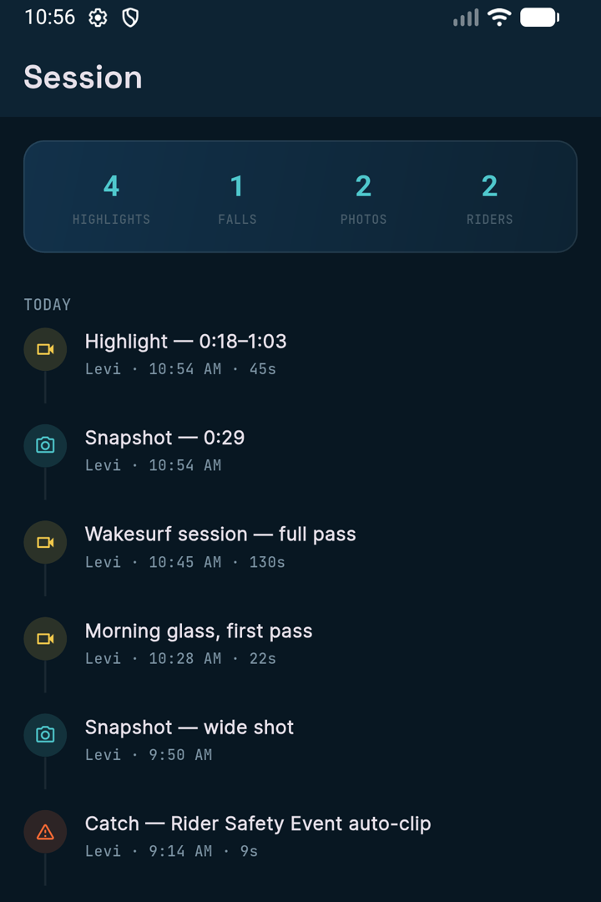 **Session**: a timeline of the day's captures. | 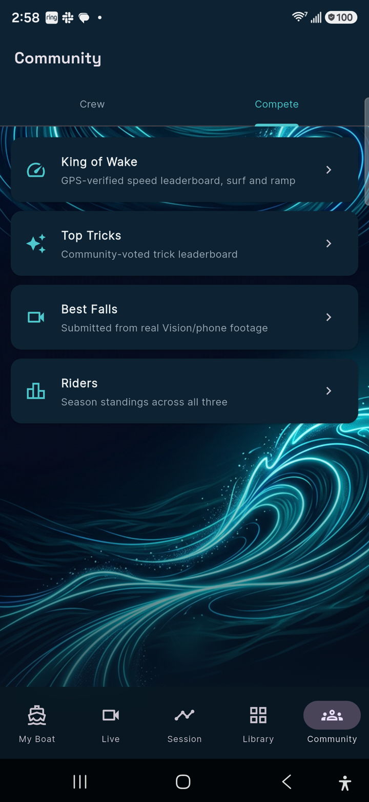 **Community**: leaderboards and crew features. | 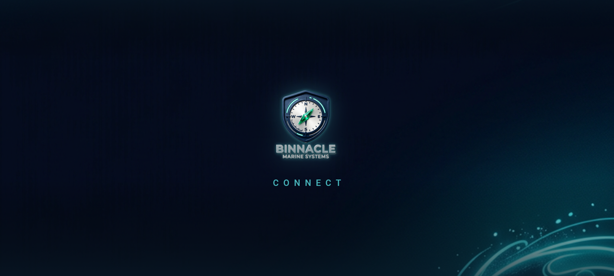 **Launch screen**. |

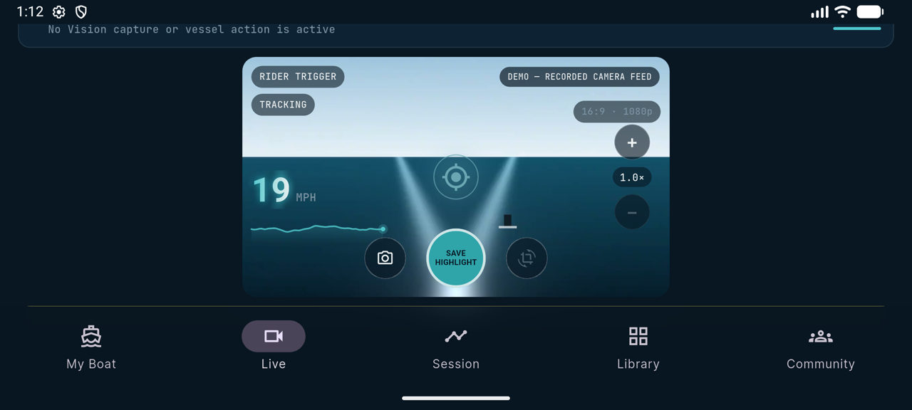

**Live in landscape**: the video is sized from the visible viewport so the whole frame, HUD and capture controls fit.

**Clips** (H.264, no audio):
- [Pairing flow](media/clips/pairing-flow.mp4): scan screen, simulated pairing, unclaimed-unit warning, confirmation.
- [Live demo feed](media/clips/live-demo-feed.mp4): live HUD, digital zoom, snapshot and highlight capture.
- [Library playback](media/clips/library-playback.mp4): opening and playing a saved highlight.

More detail: [ARCHITECTURE.md](ARCHITECTURE.md) · [Interview walkthrough](docs/interview-walkthrough.md)

**Spin-off package:** I extracted and generalized Connect's device-pairing code into [flutter_secure_pairing](https://github.com/levi-stoddard/flutter_secure_pairing), a Flutter package with on-device keys, a transport-agnostic pairing flow, a threat model and CI.

## Want to see it live?

I'm happy to screen-share the running app and the test suite on request. Reach me on [LinkedIn](https://www.linkedin.com/in/levi-stoddard).

---

Documentation and media © 2026 Levi Stoddard. All rights reserved; published for portfolio review only, and any other use needs my written permission (see [LICENSE](LICENSE)). Binnacle, Binnacle Connect and the Binnacle logo are trademarks of Binnacle Marine Systems.
